# Prompt2Robo model duel (Mac)

Type a request. Two language models each write a `run(robot)` program, and both programs run side by side in a live MuJoCo simulation. Held-out examples are scored automatically.

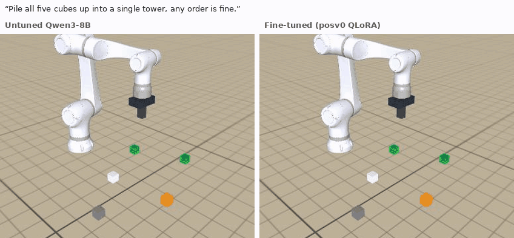

## Start

You need an Apple-Silicon Mac (16 GB RAM or more is best), Python 3.10 or newer and about 10 GB of free disk.

1. Download this repo.
2. Double-click `run_mac.command`, or run `sh run_mac.sh` in Terminal.
3. The first start takes a few minutes, then http://localhost:8766 opens. Models download when you first use them.

`sh run_mac.sh --mock` tries the page with fake models and no download. `P2R_PORT=9000 sh run_mac.sh` uses another port.

## Examples

These are real programs written by the models, run in the simulator. They are hand-picked successes: the same fine-tuned model solved 218 of 306 held-out examples, and most of the untuned model's programs fail.

**Untuned Qwen3-8B against the fine-tuned model**

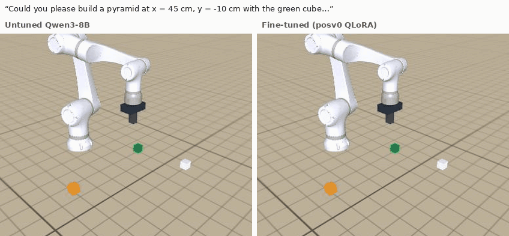
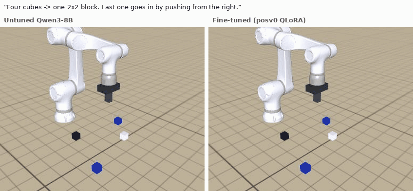

**Plain requests, fine-tuned model**

| | |
|---|---|
| 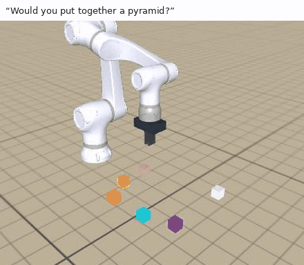 | 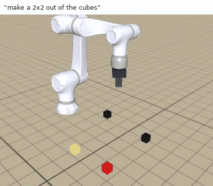 |
| 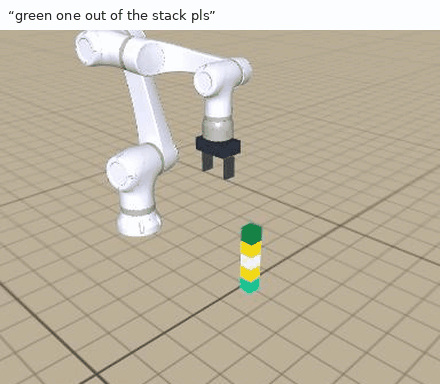 | 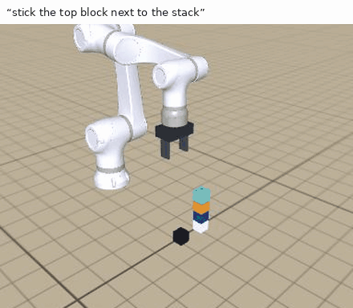 |
| 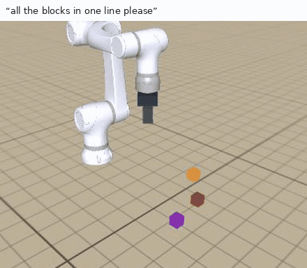 | 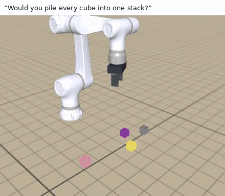 |

## The page

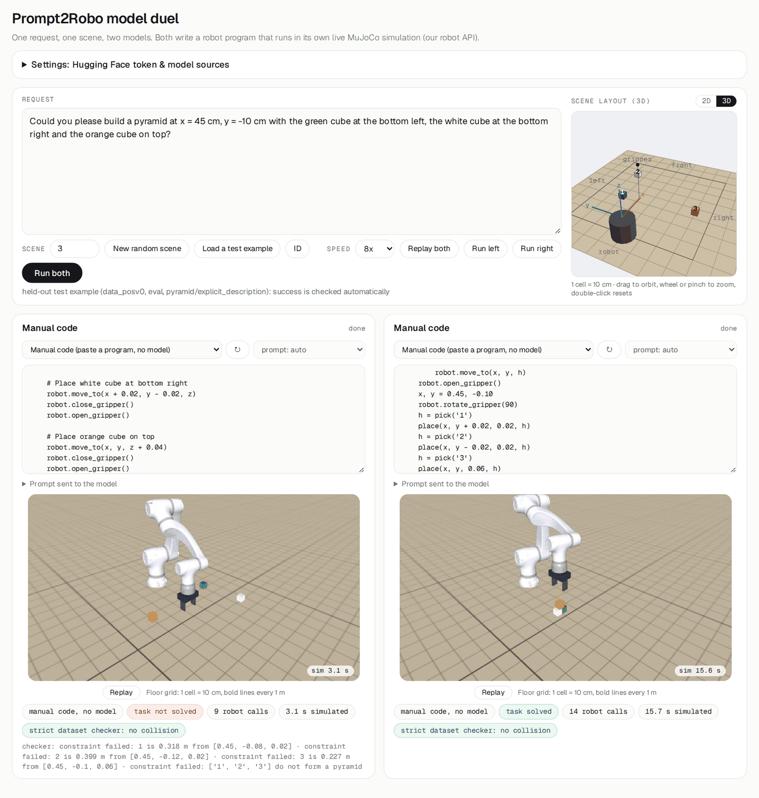

- **Models:** each side has a picker with base models, full models and adapters. Selecting one downloads it if needed and frees the side's old model.
- **Manual code:** the last picker entry runs a pasted `def run(robot):` program, no model needed.
- **Scene:** make a random scene with any number of cubes, or load a test example. Drag the 3D layout to look around.
- **Run:** run the left side, the right side or both, then **Replay** the recording at any speed.
- **Chain prompt:** under each simulation. The end state of that side becomes the new scene and the request box is cleared, so the next request continues from there. A cube still in the gripper is let go.
- **Result:** a run always plays to the end. The panel shows whether the task was solved and what the stricter dataset checker would have flagged.
- **Prompt format:** *Auto* picks what the model was trained with, or choose *Objects line* or *Scene_Info JSON* yourself.

**ID** finds any example by id, in any dataset version and split:

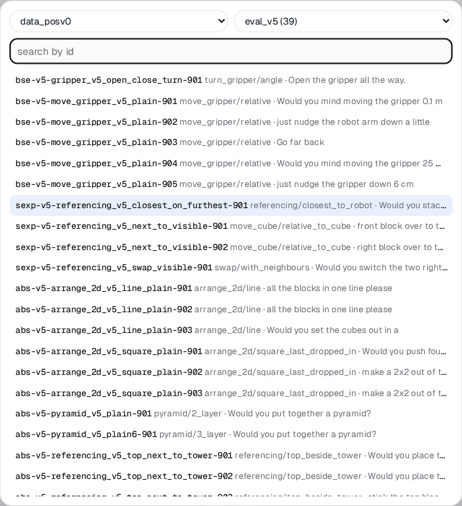

## Models

Public models work without a token. For private ones, open **Settings** and paste a Hugging Face token that can read them, or set `HF_TOKEN`. **Other…** in the picker takes a folder path or a Hugging Face link.

| Name ends in | What it is |
|---|---|
| `-MLX-4bit` | Quantized for MLX, the fast choice |
| `-full` | bf16 weights, loaded by MLX |
| `-MLX-adapter` | LoRA adapter in MLX format, runs on a 4-bit base |
| `-adapter` | PEFT adapter. Needs `.venv/bin/pip install torch peft`, a 16 GB base and a lot of RAM, so prefer the MLX version |

The best public model to start with is `Prompt2Robo v3-full-4b, Qwen3-4B · MLX 4-bit` (2.3 GB, 131 of 163 solved).

## Good to know

- If memory runs out, the panel says so. Choose a 4-bit model instead.
- Programs run in a sandbox: no imports, only the robot API.
- The arm in the picture is the NEURA LARA 5 model by [Stack Lab](https://github.com/carlo2004/Simulation-Neura-LARA-5). It is drawn only: physics and checks use the simulator's generic arm. Its meshes download on first start (see `lara5/NOTICE.md`), and `P2R_ARM=generic` turns it off.
- A shared copy of the app can contain `hf_readonly_token.txt`. Treat such a copy like a password. The file is ignored by git.

## Files

| Path | Purpose |
|---|---|
| `server.py`, `static/index.html` | Web server and page |
| `models_scan.py`, `llm_backends.py` | Model discovery and MLX/Transformers backends |
| `sim_worker.py`, `floor_view.py`, `lara_view.py`, `lara_assets.py` | Simulation runs and picture |
| `sim/` | Scene, robot API and checker from the dataset repo |
| `datasets/`, `examples.jsonl` | Dataset versions for the ID search, held-out examples |
